# 🎯 Python 퀴즈 게임 개요

터미널에서 실행하는 파이썬 퀴즈 게임입니다.  
객관식 문제를 풀고 점수를 기록할 수 있어요.

---

## 📌 퀴즈 주제 선정 이유

이 게임의 퀴즈 주제는 **파이썬 기초 문법**입니다.
선정 이유는 다음과 같아요.

- 파이썬을 처음 배우는 사람도 쉽게 풀 수 있어요
- 문제를 풀면서 배운 내용을 복습할 수 있어요
- 정답과 오답을 바로 확인할 수 있어서 학습에 도움이 돼요

---

## ▶ 실행 방법

### 1. 저장소 다운로드

```bash
git clone https://github.com/KimJonMin/1-2.git
cd 1-2
```


### 2. 게임 실행

```bash
python3 quiz_fianl.py
```
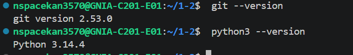


<table>
<tr>
<td width="60%">

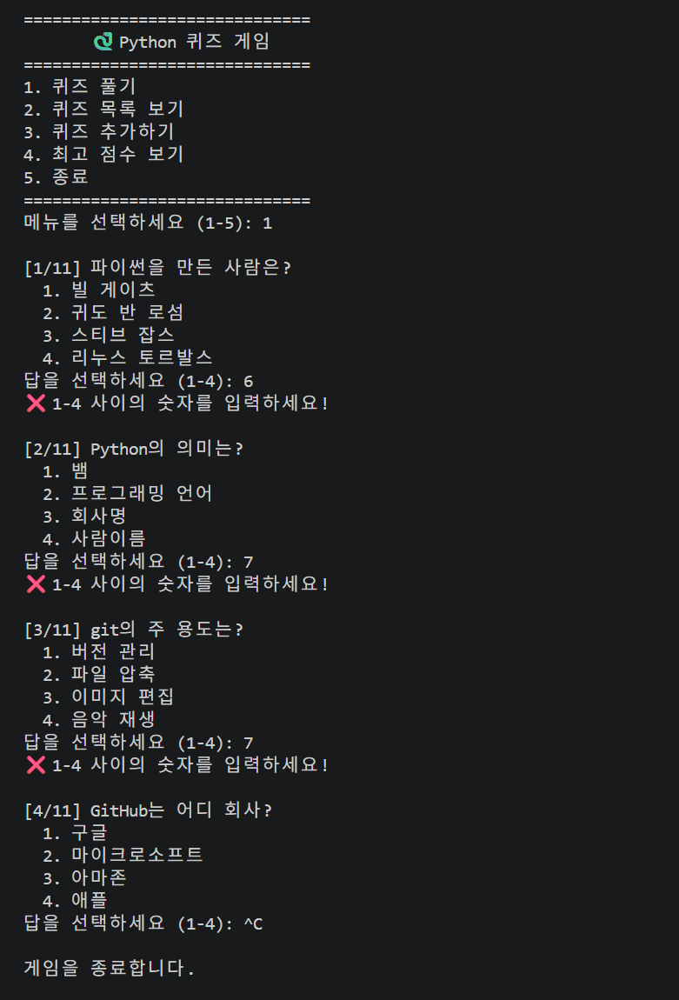

</td>
<td width="40%">

### 3. 메뉴 선택

```
=============================
       🐍 Python 퀴즈 게임
=============================
1. 퀴즈 풀기
2. 퀴즈 목록 보기
3. 퀴즈 추가하기
4. 최고 점수 보기 
5. 종료
=============================
번호를 입력하세요:
```

> 💡 1~4 숫자를 입력하고 Enter 를 누르세요.

</td>
</tr>
</table>

---

## 🛠 기능 목록

| 번호 | 기능 | 설명 |
|------|------|------|
| 1 | 퀴즈 시작 | 랜덤으로 문제를 출제하고 정답을 확인 |
| 2 | 퀴즈 목록 보기 | 풀이할 문제들을 나열
| 3 | 퀴즈 추가하기 | 추가할 문제를 기록 |
| 4 | 최고 점수 보기 | 최종 점수 합계 |
| 5 | 종료 | 게임 종료 |

---

## 📁 파일 구조

```
python-quiz-game/
│
├── main.py          # 프로그램 시작점, 메뉴 화면
├── quiz_fianl.py    # Quiz 클래스 정의(퀴즈 한 문제라는 '레시피'를 정의)
├── storage.py       # state.json 파일을 읽고 쓰는 (저장/불러오기)
├── state.json       # 실제데이터(점수, 문제)가 저장 (자동 생성)
├── test_quiz.py     # 기능이 잘 작동하는지 테스트 용도
├── .gitignore       # Git 제외 파일 목록
└── README.md        # 프로젝트 설명 (이 파일)
```

학습 포인트: 왜 파일을 이렇게 나누나요?
이미지처럼 파일을 나누면 다음과 같은 장점이 있습니다.

* 가독성: 한 파일에 코드가 수천 줄 있는 것보다, 기능별로 나누어져 있어 찾기 
         쉽습니다.
* 유지보수: 저장 기능에 문제가 생기면 storage.py만 확인하면 되고, 퀴즈 
         로직이 궁금하면 quiz_final.py만 보면 됩니다.
* 전문성: main.py는 아주 가볍게 유지하고, 실제 복잡한 일은 다른 부품(모듈)
         들이 나누어서 처리하는 방식이 실제 현업에서 쓰는 방식입니다.

---

## 📂 데이터 파일 설명

### 📄 state.json — 퀴즈 문제 데이터

퀴즈 문제, 선택지, 정답이 저장된 파일이에요.  
게임을 실행하면 이 파일에서 문제를 불러와요.

```json
{
  "state": [
    {
      "question": "파이썬을 만든 사람은 누구인가요?",
      "choices": ["제임스 고슬링", "귀도 반 로섬", "리누스 토르발스", "빌 게이츠"],
      "answer": 2
    }
  ]
}
```

| 항목 | 설명 |
|------|------|
| `question` | 문제 텍스트 |
| `choices` | 선택지 4개 (리스트) |
| `answer` | 정답 번호 (1~4) |

---

> 💡 `state.json` 은 처음 실행할 때 자동으로 만들어져요.  
> 직접 수정하지 않아도 돼요.

---


# 📚 Python 퀴즈 게임 — 학습 정리

---

# 1️⃣ Python 기초

## ✅ 변수
> 변수란 **데이터를 담는 상자**예요.

```python
name = "홍길동"    # 상자 이름: name, 담긴 값: "홍길동"
age  = 20         # 상자 이름: age,  담긴 값: 20
```

**왜 사용하나요?**
- 값을 저장해두고 나중에 다시 꺼내 쓸 수 있어요
- 같은 값을 여러 번 쓸 때 변수 하나만 바꾸면 돼요

---

## ✅ 자료형 5가지

| 자료형 | 의미 | 예시 |
|--------|------|------|
| `int` (Integer)| 정수 | `10`, `-3`, `0` |
| `str` (String)| 문자열 | `"안녕"`, `"hello"` |
| `bool`(Boolean)| 참/거짓 | `True`, `False` |
| `list`(List)| 순서 있는 목록 | `[1, 2, 3]` |
| `dict`(Dictionary)| 키-값 쌍 | `{"name": "홍길동"}` |

```python
age     = 20              # int
name    = "홍길동"         # str
is_pass = True            # bool
scores  = [90, 80, 70]    # list
person  = {"name": "홍길동", "age": 20}  # dict
```

---

## ✅ 조건문 if / elif / else
> 조건에 따라 **다른 동작**을 수행해요.

```python
score = 85

if score >= 90:
    print("A 학점")       # score가 90 이상일 때
elif score >= 80:
    print("B 학점")       # score가 80 이상일 때
else:
    print("C 학점 이하")  # 위 조건이 모두 아닐 때
```

| 키워드 | 역할 |
|--------|------|
| `if` | 첫 번째 조건 확인 |
| `elif` | 두 번째, 세 번째... 조건 확인 |
| `else` | 모든 조건이 아닐 때 실행 |

---

## ✅ 반복문 for vs while

```python
# for - 횟수가 정해진 반복
 핵심: "딱 3번만 해!", "리스트에 있는 거 다 꺼내와!" 처럼 끝이 정해져 있을 때 씁니다.
 비유: 운동장 3바퀴 돌기 (3바퀴 다 돌면 끝!)
 
for i in range(3):
    print(i)       # 0, 1, 2 출력

# while - 조건이 참인 동안 반복
 핵심: "정답 맞힐 때까지 계속해!", "사용자가 종료 버튼 누를 때까지 무한 반복!" 
      처럼 특정 조건이 바뀔 때까지 씁니다.
 비유: 배가 부를 때까지 먹기 (배가 부르다는 조건이 충족될 때까지 계속!)

count = 0
while count < 3:
    print(count)   # 0, 1, 2 출력
    count += 1
```

| | `for` | `while` |
|--|-------|---------|
| 언제 사용? | 반복 횟수가 **정해진** 경우 | 조건이 **만족하는 동안** |
| 예시 | 퀴즈 7문제 출제 | 정답 입력할 때까지 반복 |

---

## ✅ 함수

```python
# 함수 정의
def add(a, b):       # a, b = 매개변수
    result = a + b
    return result    # 반환값

# 함수 호출
total = add(3, 5)
print(total)         # 8
```

| 용어 | 설명 |
|------|------|
| `def` | 함수를 만들 때 쓰는 키워드 |
| 매개변수 | 함수에 전달하는 값 (`a`, `b`) |
| `return` | 함수가 돌려주는 값 |

### 1. `def` : 마법 상자 만들기 (정의)
*   **의미**: "이제부터 이런 기능을 하는 상자를 만들 거야!"라고 선언하는 것입니다.
*   **약자**: `def`는 '정의하다'라는 뜻의 **define**에서 따왔습니다.
*   **비유**: 실제 믹서기를 만들기 전, **믹서기 설계도**를 그리는 과정입니다.

### 2. 매개변수 `(a, b)` : 재료 넣기 (입력)
*   **의미**: 함수가 일을 하기 위해 필요한 **재료**입니다.
*   **비유**: 믹서기에 넣는 **'사과'**와 **'당근'** 같은 것입니다.
*   **예시**: `add(3, 5)`라고 호출하면, `a`라는 통에는 `3`이, `b`라는 통에는 `5`라는 재료가 담깁니다.

### 3. `return` : 결과물 돌려받기 (출력)
*   **의미**: 함수가 모든 작업을 끝내고 나에게 주는 **최종 결과물**입니다.
*   **비유**: 믹서기가 다 돌아가고 컵에 담겨 나온 **'사과당근 주스'**입니다.
*   **중요성**: `return`이 있어야만 그 결과를 변수에 담아 다른 곳에서 또 사용할 수 있습니다.


---

# 2️⃣ 클래스와 객체

## ✅ 클래스란?
> 클래스는 **설계도**, 객체는 **설계도로 만든 실제 물건**이에요.

```
클래스 = 붕어빵 틀
객체   = 붕어빵 틀로 만든 붕어빵
```

**왜 사용하나요?**
- 관련된 데이터와 기능을 **하나로 묶을 수 있어요**
- 같은 설계도로 **여러 객체**를 만들 수 있어요

---

## ✅ `__init__` 과 `self`

```python
class Quiz:
    def __init__(self, question, answer):
        #          ↑ 객체 만들 때 자동 실행
        self.question = question
        self.answer   = answer
        # ↑ self = 지금 만들어지는 이 객체 자신

# 객체 생성
q = Quiz("파이썬을 만든 사람은?", 2)
print(q.question)   # 파이썬을 만든 사람은?
```

| 용어 | 설명 |
|------|------|
| `__init__` | 객체를 만들 때 **자동으로 실행**되는 함수 |
| `self` | **지금 이 객체 자신**을 가리키는 말 |

---

### 1. `__init__` : "탄생과 동시에 세팅!" (초기화)
*   **의미**: 객체가 만들어질 때(태어날 때) **자동으로 호출**되는 특수한 함수입니다.
*   **용어**: 'Initialize(초기화하다)'의 약자입니다.
*   **역할**: 퀴즈 객체가 태어나자마자 문제(question)와 정답(answer)을 가질 수 있도록 **기본 세팅**을 해줍니다.
*   **비유**: 아기가 태어나자마자 이름표를 달아주고 배냇저고리를 입혀주는 것과 같습니다.

### 2. `self` : "이건 내 거야!" (자기 자신)
*   **의미**: '지금 막 만들어진 **바로 그 객체 자신**'을 가리키는 대명사입니다.
*   **역할**: 클래스 내부에서 "이 데이터는 외부의 것이 아니라, **나(self)의 변수**에 저장할 거야!"라고 선언하는 것입니다.
*   **비유**: 여러 명의 학생이 있을 때, 각자가 "내(self) 이름은 철수야", "내(self) 이름은 영희야"라고 자기 정보를 관리하는 것과 같습니다.


---

## ✅ 속성과 메서드

```python
class Quiz:
    def __init__(self, question, answer):
        self.question = question   # 속성 (데이터)
        self.answer   = answer     # 속성 (데이터)

    def display(self):             # 메서드 (기능)
        print(self.question)

    def check(self, user_answer):  # 메서드 (기능)
        return self.answer == user_answer
```

| 용어 | 설명 | 예시 |
|------|------|------|
| 속성 | 객체가 가진 **데이터** | `self.question` |
| 메서드 | 객체가 가진 **기능** | `display()`, `check()` |

  *속성 (Attribute): 객체가 가지고 있는 상태나 데이터입니다. 
                    (예: 붕어빵의 내용물, 굽기 정도)
                 => 명사! (이름, 나이, 문제, 정답)
  *메서드 (Method): 객체가 할 수 있는 행동이나 기능입니다. 
                  (예: 붕어빵이 따끈하게 데워지기)
                 => 동사! (걷다, 먹다, 출력하다, 확인하다)

---


# 3️⃣ 파일 입출력

## ✅ 파일 열기 / 읽기 / 쓰기

```python
# 파일 쓰기
with open("test.txt", "w") as f:
    f.write("안녕하세요")

# 파일 읽기
with open("test.txt", "r") as f:
    content = f.read()
    print(content)   # 안녕하세요
```

| 모드 | 의미 |
|------|------|
| `"r"` | 읽기 (파일이 없으면 오류) |
| `"w"` | 쓰기 (파일이 없으면 새로 생성) |
| `"a"` | 이어쓰기 (기존 내용 유지) |

---

## ✅ JSON(JavaScript Object Notation) 이란?
> 데이터를 **텍스트로 저장**하는 형식이에요.  
> **속성(Key)**과 **값(Value)**이 한 쌍으로 이루어져 있습니다.
> 파이썬의 딕셔너리/리스트와 생김새가 거의 같아요.

```python
import json

# 딕셔너리 → JSON 파일로 저장
data = {"name": "홍길동", "score": 5}

with open("state.json", "w") as f:
    json.dump(data, f)

# JSON 파일 → 딕셔너리로 불러오기
with open("state.json", "r") as f:
    loaded = json.load(f)
    print(loaded["score"])   # 5
```

| 함수 | 설명 |
|------|------|
| `json.dump()` | 딕셔너리 → JSON 파일로 **저장** |
| `json.load()` | JSON 파일 → 딕셔너리로 **불러오기** |

예시 (학생 정보):
{
  "이름": "홍길동",
  "나이": 20,
  "학생여부": true,
  "취미": ["독서", "코딩"]
}
**중괄호 { }**로 전체를 감쌉니다.
**큰따옴표 " "**를 사용해 속성 이름(Key)을 적습니다.
**콜론 :**으로 이름과 값을 구분합니다.

---

### ✨ JSON의 주요 장점

1. 👀 **읽기 쉽다 (Human-Readable)**
   * 사람도 눈으로 바로 이해할 수 있을 만큼 구조가 직관적입니다.
   * `key: value` (이름: 값) 쌍으로 이루어져 있어 어떤 데이터인지 한눈에 알 수 있습니다.

2. 🎈 **가볍다 (Lightweight)**
   * 순수한 텍스트로만 이루어져 있어 용량이 매우 작습니다.
   * 데이터 전송 속도가 빨라야 하는 인터넷 환경에 최적화되어 있습니다.

3. 🌍 **언어 독립적 (Language Independent)**
   * 자바스크립트에서 시작되었지만, 현재는 **파이썬, 자바, C++, Go** 등 거의 모든 프로그래밍 언어가 JSON을 읽고 쓸 수 있습니다.
   * 서로 다른 언어로 만든 프로그램들이 대화할 때 쓰는 **'공용어'** 역할을 합니다.

---

### 🛠️ 실무에서는 어떻게 쓰일까?

1. ☁️ **웹 API (Application Programming Interface)**
   * 날씨 앱이 기상청 서버에서 오늘 기온 데이터를 받아올 때, 대부분 JSON 형식을 사용합니다.
   * 스마트폰 앱과 서버가 대화하는 가장 대중적인 방식입니다.

2. ⚙️ **설정 파일 (Configuration)**
   * 프로그램의 환경 설정(다크 모드 여부, 폰트 크기, 언어 설정 등)을 저장할 때 사용합니다.
   * VS Code 같은 유명한 개발 도구들도 설정 저장에 JSON을 활용합니다.

3. 🗄️ **데이터베이스 (Database)**
   * 데이터를 구조화해서 저장할 때 활용됩니다.
   * 특히 MongoDB 같은 NoSQL 데이터베이스는 JSON과 매우 유사한 형태로 데이터를 관리합니다.


---

## ✅ try / except — 오류 처리
 프로그램이 갑자기 멈추는(크래시) 경우의 상황을 대비해 만드는 '안전장치' 혹은 **'보험'** (프로그램이 갑자기 꺼지는 것을 막아 사용자에게 친절한 안내)

기본 개념: "일단 해보고, 안 되면 이렇게 해!"
* try 블록: "이 코드를 일단 실행해봐." 
           (오류가 발생할 가능성이 있는 코드)
           에러가 날 것 같은 코드를 가둬두는 곳.
* except 블록: "만약 에러가 나면, 프로그램을 멈추지 말고 이 처리를 해줘."  
             (에러 발생 시 대처 방안)
             에러가 났을 때 프로그램이 죽지 않게 심폐소생술을 하는 곳.


```python
try:
    with open("state.json", "r") as f:
        data = json.load(f)
except FileNotFoundError:
    # 파일이 없을 때 실행
    data = {"records": []}
```

| 키워드 | 역할 |
|--------|------|
| `try` | 오류가 날 수 있는 코드 실행 |
| `except` | 오류가 났을 때 대신 실행 |

---

# 4️⃣ Git 기초

## ✅ Git 이란?
> **코드의 변경 기록을 저장**하는 도구예요.

**왜 필요한가요?**
- 실수로 코드를 망쳐도 **이전 상태로 되돌릴 수 있어요**
- 여러 사람이 **동시에 작업**할 수 있어요

---


## ✅ 핵심 명령어 7가지

```bash
# 1. init - 이 폴더를 Git으로 관리 시작
git init

# 2. add - 저장할 파일 선택
git add .

# 3. commit - 선택한 파일 저장 (스냅샷 찍기)
git commit -m "메시지"

# 4. push - GitHub에 올리기
git push

# 5. pull - GitHub에서 최신 내용 가져오기
git pull

# 6. checkout - 브랜치 이동 또는 파일 되돌리기
git checkout 브랜치이름

# 7. clone - GitHub 저장소를 내 컴퓨터로 복사
git clone 주소
```

| 명령어 | 한 줄 설명 |
|--------|-----------|
| `init` | Git 관리 시작 |
| `add` | 저장할 파일 선택 |
| `commit` | 변경사항 저장 |
| `push` | GitHub에 올리기 |
| `pull` | GitHub에서 가져오기 |
| `checkout` | 브랜치 이동 |
| `clone` | 저장소 복사 |

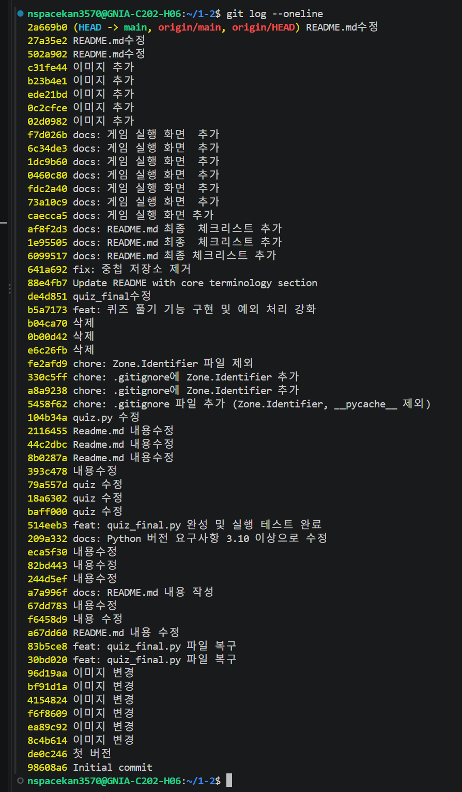
---


## ✅ 브랜치 생성과 병합
Git 브랜치(Branch)를 생성하고, 작업한 내용을 다시 메인 줄기에 합치는(Merge) 과정을 설명

```bash
# 브랜치 생성 + 이동
git checkout -b feature/quiz
  : 지금 상태를 그대로 복사해서 feature/quiz라는 이름의 새로운 작업 공간을 
    만들고, 거기로 바로 이동

# 작업 후 커밋
git add .
git commit -m "feat: 퀴즈 기능 추가"

# main 브랜치로 이동
git checkout main

# 병합
git merge feature/quiz
```

> 💡 브랜치는 **작업용 복사본**이에요.  
> 원본(main)을 건드리지 않고 새 기능을 만들 수 있어요.

---

## ✅ clone 과 pull

```bash
# clone - 처음 저장소를 내 컴퓨터로 가져올 때
          (프로젝트에 처음 참여할 때, 혹은 내 컴퓨터에 해당 코드 폴더가 아예 없을 때 사용)

git clone https://github.com/아이디/python-quiz-game.git

# pull - 이미 clone한 저장소의 최신 내용을 가져올 때
        (이미 clone을 해서 내 컴퓨터에 폴더가 있을 때, 다른 사람이 새로 올린(Push한) 최신 내용을 가져오고 싶을 때 사용)

git pull
```

| | `clone` | `pull` |
|--|---------|--------|
| 언제? | **처음** 가져올 때 | **이미 있는** 저장소 업데이트 |

---
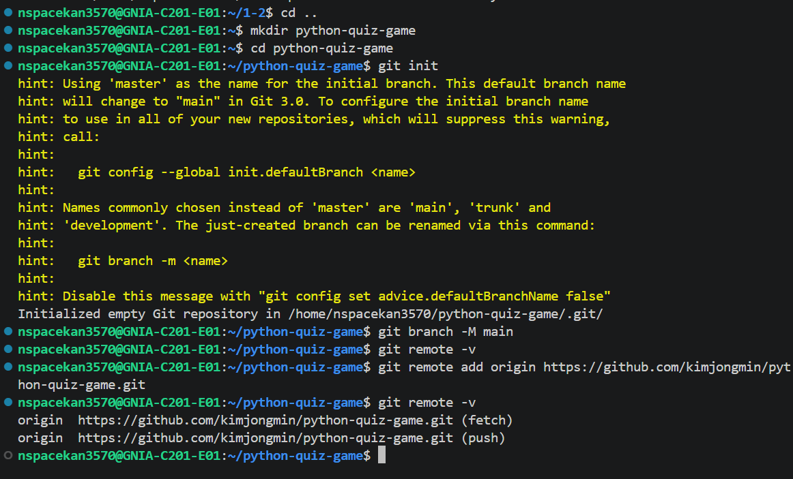
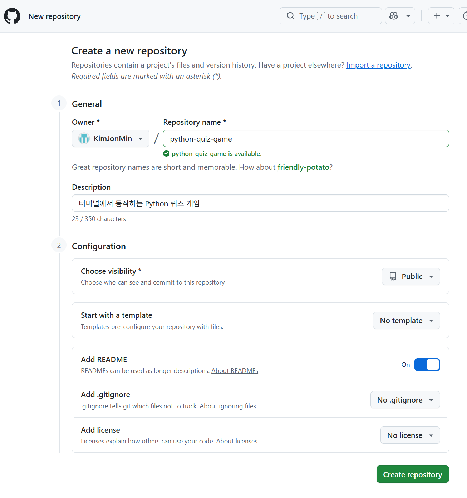
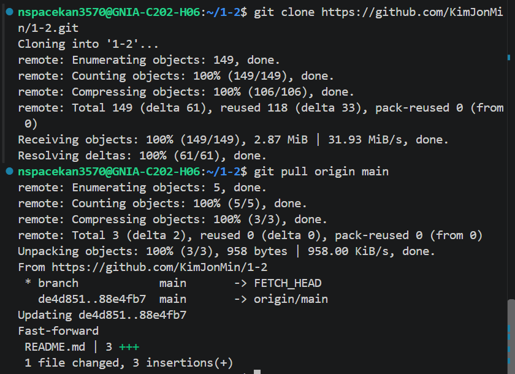

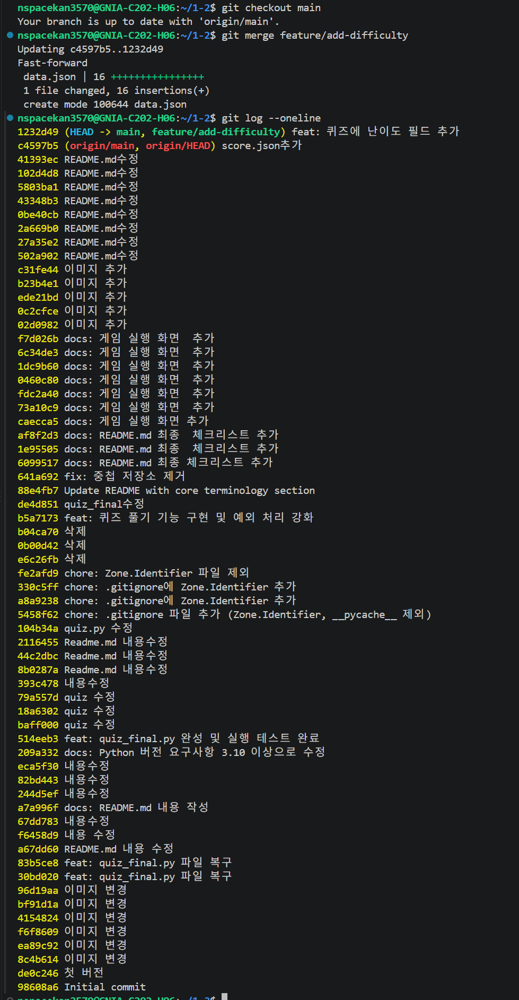

---

### 2. quiz_final.py 코드 작성

```python
class Quiz:
    """퀴즈 하나를 표현하는 클래스"""

    def __init__(self, question, choices, answer):
        self.question = question   # 문제
        self.choices  = choices    # 선택지 리스트
        self.answer   = answer     # 정답 번호 (1~4)

    def display(self):
        """문제와 선택지를 출력"""
        print(f"\n📝 {self.question}")
        for i, choice in enumerate(self.choices, start=1):
            print(f"  {i}. {choice}")

    def check_answer(self, user_answer):
        """정답이면 True, 오답이면 False 반환"""
        return self.answer == user_answer
```
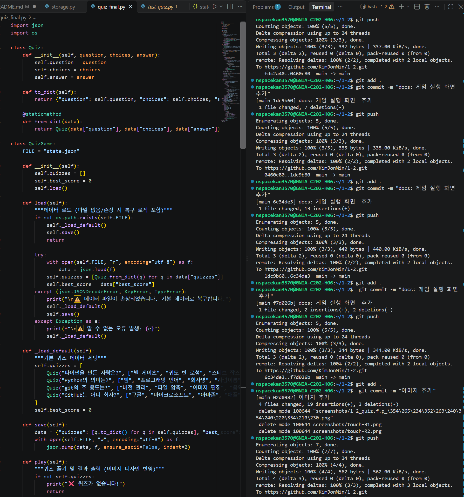

---

## 코드 설명

| 코드 | 설명 |
|------|------|
| `class Quiz:` | 퀴즈를 담는 설계도(클래스) |
| `__init__()` | 객체를 만들 때 자동으로 실행되는 함수 |
| `self.question` | 이 객체의 문제를 저장 |
| `self.choices` | 이 객체의 선택지를 저장 |
| `self.answer` | 이 객체의 정답 번호를 저장 |
| `display()` | 문제와 선택지를 출력하는 함수 |
| `check_answer()` | 정답 여부를 확인하는 함수 |
| `enumerate(list, start=1)` | 리스트를 1번부터 번호 붙여 순회 |

---

### 3. state.json 파일 만들기

```bash
touch state.json
```

---

### 4. state.json 데이터 작성

```json
{
  "quizzes": [
    {
      "question": "파이썬(Python)을 만든 사람은 누구인가요?",
      "choices": ["제임스 고슬링", "귀도 반 로섬", "리누스 토르발스", "빌 게이츠"],
      "answer": 2
    },
    {
      "question": "다음 중 파이썬의 리스트(list)를 만드는 올바른 방법은?",
      "choices": ["list = (1, 2, 3)", "list = {1, 2, 3}", "list = [1, 2, 3]", "list = <1, 2, 3>"],
      "answer": 3
    },
    {
      "question": "파이썬에서 주석을 작성할 때 사용하는 기호는?",
      "choices": ["//", "/* */", "--", "#"],
      "answer": 4
    },
    {
      "question": "파이썬에서 아무것도 없음을 나타내는 값은?",
      "choices": ["null", "undefined", "None", "empty"],
      "answer": 3
    },
    {
      "question": "다음 중 파이썬의 반복문이 아닌 것은?",
      "choices": ["for", "while", "loop", "for ~ in"],
      "answer": 3
    },
    {
      "question": "파이썬에서 함수를 정의할 때 사용하는 키워드는?",
      "choices": ["function", "func", "def", "define"],
      "answer": 3
    },
    {
      "question": "파이썬 딕셔너리(dictionary)를 만드는 올바른 방법은?",
      "choices": ["[key: value]", "{key: value}", "(key: value)", "<key: value>"],
      "answer": 2
    }
  ]
}
```

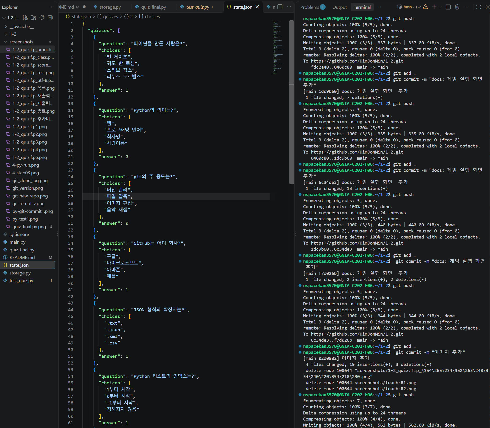


> 💡 **JSON 이란?**  
> 데이터를 저장하는 텍스트 형식이에요.  
> `{ }` 는 딕셔너리, `[ ]` 는 리스트와 같아요.

# 💾 state.json: 프로그램의 기억 저장소 (Storage)

이 파일은 우리 퀴즈 프로그램의 **'기억 장치'** 역할을 수행합니다. 프로그램이 종료되어도 사라지면 안 되는 중요한 데이터들을 안전하게 보관합니다.

## 📋 주요 역할

### 1. 데이터의 영구 저장 (Persistence)
*   **퀴즈 데이터 보관**: 문제, 선택지, 정답 데이터를 파일 형태로 저장합니다.
*   **RAM vs DISK**: 프로그램 실행 중에만 잠깐 메모리(RAM)에 머무는 것이 아니라, 하드디스크(DISK)에 물리적인 파일로 기록됩니다. 덕분에 **컴퓨터를 껐다 켜도 데이터가 사라지지 않습니다.**

### 2. 사용자 기록 유지 (Save File)
*   **최고 점수 및 전적 관리**: 사용자가 이전에 플레이했던 기록을 기억합니다.
*   게임의 **'세이브 파일'**과 같은 역할을 하여, 재실행 시에도 사용자의 진행 상태를 그대로 불러올 수 있습니다.

### 3. 자동 초기화 (Auto-Initialization)
*   **파일 부재 시 대응**: 사용자가 실수로 `state.json` 파일을 지웠거나 프로그램을 처음 실행했을 때, 프로그램이 에러로 멈추지 않습니다.
*   "파일이 없네? 새로 만들어야지!"라고 스스로 판단하여 **기본 퀴즈 데이터를 자동으로 생성**합니다.

### 4. 데이터 복구 및 예외 처리 (Recovery)
*   **손상 복구 로직**: 파일 내용이 강제로 수정되어 형식이 깨진 경우(JSON Syntax Error 등), 프로그램이 튕기지 않도록 보호합니다.
*   **try / except 활용**: 
    - `try`: 파일을 읽어오려고 시도합니다.
    - `except`: 파일이 깨졌다면 안내 메시지를 출력하고, 다시 깨끗한 **기본 데이터로 덮어씌워 복구**합니다.

---

---

## 동작 확인

터미널에서 아래 명령어로 테스트해요.

```bash
python3 -c "
from quiz import Quiz
q = Quiz('파이썬을 만든 사람은?', ['고슬링', '귀도', '리누스', '빌게이츠'], 2)
q.display()
print('정답(2):', q.check_answer(2))
print('오답(1):', q.check_answer(1))
"
```

아래처럼 나오면 성공이에요 ✅
```
📝 파이썬을 만든 사람은?
  1. 고슬링
  2. 귀도
  3. 리누스
  4. 빌게이츠
정답(2): True
오답(1): False
```

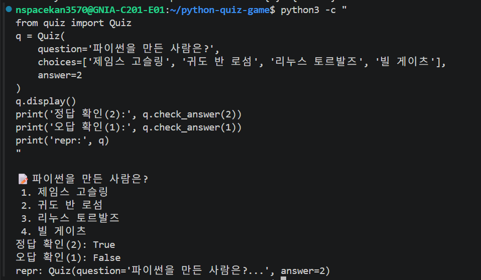
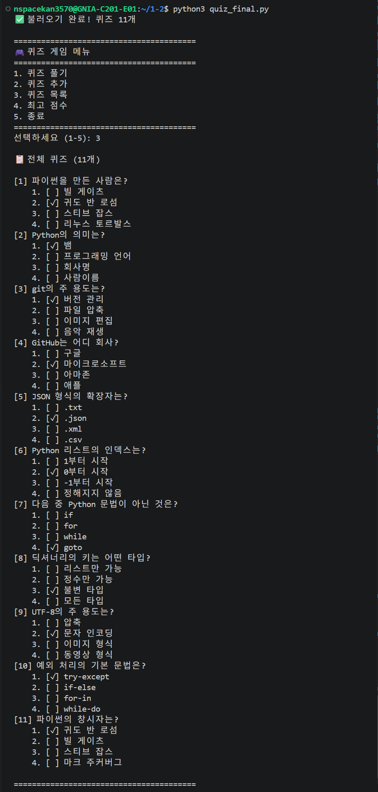
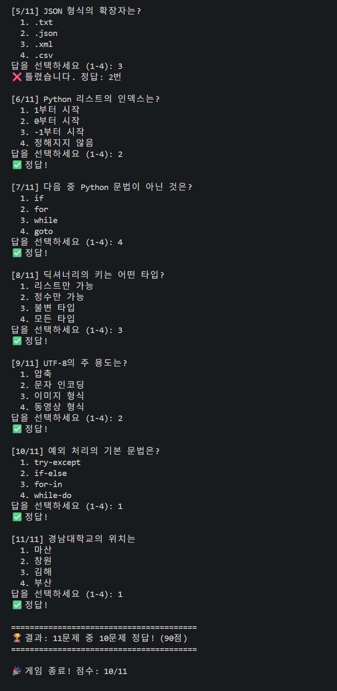
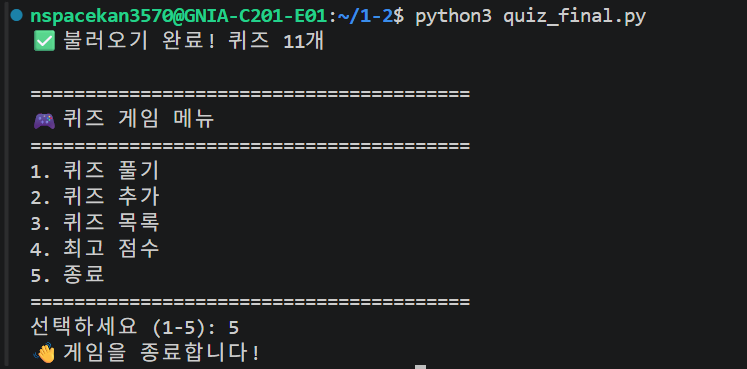
---

## Git 커밋

```bash
git add quiz.py quizzes.json Step04.md
git commit -m "feat: Quiz 클래스 및 퀴즈 데이터 추가"
git push
```

---

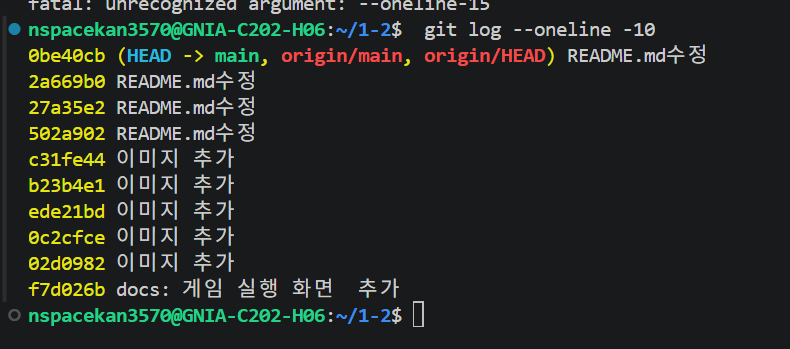
---


---

# 📋 전체 학습 목표 체크리스트

### Python 기초
- [ ] 변수가 무엇이고 왜 사용하는지 설명할 수 있다
- [ ] int, str, bool, list, dict 의 차이를 설명할 수 있다
- [ ] if/elif/else 로 조건에 따라 다른 동작을 수행할 수 있다
- [ ] for 와 while 의 차이를 설명하고 적절히 선택할 수 있다
- [ ] 함수를 정의하고 매개변수와 반환값을 활용할 수 있다

### 클래스와 객체
- [ ] 클래스가 무엇이고 왜 사용하는지 설명할 수 있다
- [ ] `__init__` 메서드와 `self` 의 역할을 설명할 수 있다
- [ ] 속성과 메서드를 정의하고 활용할 수 있다

### 파일 입출력
- [ ] 파일을 열고 읽고 쓰는 기본 과정을 설명할 수 있다
- [ ] JSON 형식이 무엇이고 왜 사용하는지 설명할 수 있다
- [ ] try/except 로 오류를 처리할 수 있다

### Git 기초
- [ ] Git 이 무엇이고 왜 필요한지 설명할 수 있다
- [ ] init, add, commit, push, pull, checkout, clone 을 설명할 수 있다
- [ ] 브랜치를 생성하고 병합할 수 있다
- [ ] clone 과 pull 의 차이를 설명할 수 있다

---

# 🎯 Python Quiz Game

제출 전 아래 항목을 모두 확인하세요!

---

## 📋 제출 전 아래 항목을 모두 확인하세요!

## ✅ 최종 제출 점검

### 💚 제출 전 최종 체크리스트

#### 📌 코드 확인

- [ ] `python main.py` 로 오류 없이 실행된다
- [ ] 퀴즈 문제가 10개 이상 있다
- [ ] 문제가 랜덤으로 출력된다
- [ ] 정답/오답이 올바르게 표시된다
- [ ] 점수가 `scores.json` 에 저장된다
- [ ] 점수 보기 메뉴가 잘 동작한다
- [ ] `Quiz` 클래스를 사용했다

#### 📌 파일 구조 확인

- [ ] `main.py` 가 있다
- [ ] `quiz_final.py` 가 있다
- [ ] `state.py` 가 있다
- [ ] `storage.py` 가 있다
- [ ] `README.md` 가 있다

#### 📌 Git 확인

- [ ] GitHub 저장소가 만들어져 있다
- [ ] 커밋이 10개 이상 있다
- [ ] 브랜치를 나눠서 작업했다
- [ ] 모든 브랜치가 `main` 에 합쳐졌다
- [ ] 커밋 메시지가 규칙에 맞게 작성됐다